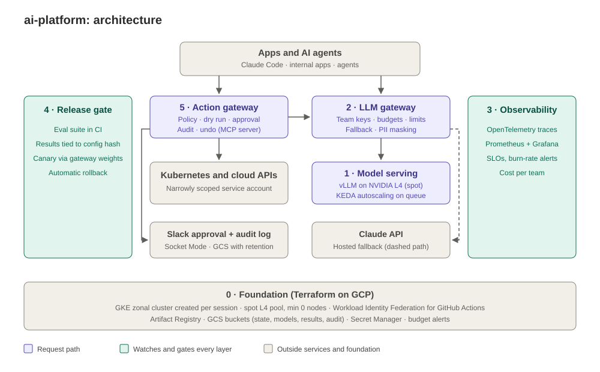

# ai-platform (working name)

An open-source reference platform for running AI in production on Google Cloud:

- self-hosted models on GPUs (graphics processing units)
- one gateway for every LLM (large language model) call
- monitoring and SLOs (service level objectives)
- eval-gated model releases
- a safety gate for AI agents that change infrastructure

It's built in public, one layer at a time. Each layer is a standalone story an enterprise team can copy, and each one runs on Terraform + GKE (Google Kubernetes Engine). Pull requests get **free checks in CI** (continuous integration), the cloud comes up **only to test**, and **everything is torn down after**.



## The five projects (plus the base they stand on)

| # | Project | The enterprise problem it solves | Status |
|---|---|---|---|
| 0 | [Foundation](projects/00-foundation/) | "Our GPU bill is huge because nobody turns anything off." | done |
| 1 | [GPU model serving](projects/01-gpu-serving/) | "We want our own model, but we don't know what it costs or how fast it is." | done |
| 2 | [LLM gateway](projects/02-llm-gateway/) | "Every team calls AI with its own keys, and nobody knows the spend." | done |
| 3 | [LLM observability & SLOs](projects/03-llm-observability/) | "The AI feature is 'up', but users wait 8 seconds." | done, except scale from zero (P3-08, not measured) |
| 4 | [Eval-gated model releases](projects/04-eval-gated-releases/) | "We swapped the model, quality dropped, and nobody noticed for a week." | done, except the upgrade demo (waits on a safety-gate decision) |
| 5 | [Agent action gateway](projects/05-agent-action-gateway/) | "We want AI agents to fix infrastructure, but we're scared they'll break prod." | built and measured; demo video and an outside install still to come |

## Results so far

Each number is copied from the project's README, which links the results file with the method and raw output.

- **P0:** the session cluster made two clean round trips: `make up` 11m39s and 11m56s, `make down` 10m18s and 10m24s ([results](projects/00-foundation/results/round-trip-2026-10-15.md)).
- **P1:** FP8 (8-bit weights) gave 657.0 output tokens/s for short chat at 32 concurrent requests, against 316.2 for BF16 (16-bit), at $0.22 per 1M output tokens on a spot GPU node (GPU node only). The median cold start fell from 571.1 s (9.5 min) to 402.3 s (6.7 min) ([results](projects/01-gpu-serving/README.md#results)).
- **P2:** 22 of 22 requests succeeded while the self-hosted model was down, through fallback to a hosted model. 0 raw PII (personally identifiable information) values reached the provider across 20 fake-PII prompts ([session 4](projects/02-llm-gateway/results/session4-gateway-full-2026-10-19.md)).
- **P3:** a game day caught three induced failures: a latency flood in 5.7 min (ticket), vLLM killed in 11.5 min (10 min of that is the alert rule's built-in wait), and the hosted model blocked in 2.3 min (ticket). Self-hosted cost was $1.61 per 1M output tokens with vLLM saturated, at the GPU node's on-demand list price (P1's $0.22 is the spot price) ([session 2 retry](projects/03-llm-observability/results/session2-retry-obs-full-2026-10-21.md)).
- **P4:** the eval gate's red PR check blocked a deliberately weaker model (Qwen2.5-1.5B): Q&A judge score 3.825 against the baseline's 4.625, structured output 95% (gate 98%), instruction following 80% against 85%. A canary rolled itself back 2 min 55 s after it started, on time to first token (1.949 s against a 0.817 s limit). One 100-case eval run costs $0.27–$0.30 self-hosted and $0.18 on Gemini Flash-Lite. The judge gave the owner's exact score on 13 of 20 answers ([results](projects/04-eval-gated-releases/README.md#results)).
- **P5:** in 50 scenarios on kind in CI and again on GKE, 0 of 15 unsafe agent actions were allowed and 0 of 20 safe ones wrongly blocked; 15 of 15 risky actions went to a human, 6 of 6 prompt-injection attempts were blocked, and undo restored 30 of 30 reversible changes. Claude Code, as the agent, scaled a production deployment only after a Slack approval, then undid it ([results](projects/05-agent-action-gateway/README.md#results)).

## How to run it

Cloud work happens in a session: a GKE zonal cluster plus one NVIDIA L4 GPU (spot or on-demand), at $[X] per session (not measured yet). A session can run unattended from GitHub Actions ([`gpu-session.yml`](.github/workflows/gpu-session.yml)). First-time setup is in [Project 0](projects/00-foundation/).

```bash
# One session = create, test, destroy
make up LAYERS="01 02 03 04 05"  # Terraform creates the session cluster, then deploys those layers
make test P=03             # run one project's tests against the cluster
make bench                 # P1 benchmarks
make down                  # deletes everything except the cheap foundation
make status                # proves nothing billable is still running
```
