# P2: LLM gateway

One front door for every AI call: a gateway in front of the self-hosted model (P1) and a hosted model. Each team gets its own key, budget and rate limit. A request falls back to the hosted model when ours is down, and personal data in every request is masked before it leaves.

**Status:** built and measured from 2026-10-18 to 2026-10-19: a CI spike, tests in CI containers on every pull request, and four `gpu-session.yml` runs. Every session's results file records its teardown `make status` reporting "nothing billable is running". The overhead benchmark's run is INVALID under its own rule; the published overhead comes from one round of it, by user decision (see [Overhead](#overhead)).



## What it runs

- **Gateway:** LiteLLM v1.103.3, open-source features only, with no license key set ([spike](results/spike-2026-10-18.md)). Postgres holds teams, keys and spend. It's one pod with no disk, so its data lasts one session.
- **Two model names (aliases):**
  - `chat-default`: our vLLM (P1), falling back to the hosted model. It falls back after 10 s without a first token (streaming) or 30 s in all. Self-hosted calls cost $0.00000075 per output token, P1's measured cost, so team budgets count them too.
  - `chat-hosted`: Gemini (`gemini-3.5-flash-lite`) on Vertex AI. The gateway logs in with GKE Workload Identity, so there is no API key to store. A streaming answer must start within 10 s and a whole answer finish within 60 s. Without these limits LiteLLM waits 6,000 s, so a hung Vertex AI would hold requests for 100 minutes (added 2026-10-20).
- **PII masking:** Presidio 2.2.362 masks emails, phone numbers, card numbers, names, US SSNs, IBANs and IP addresses in every request, fallbacks included (PII: personally identifiable information). The tests cover emails, phone numbers and card numbers.
  - **Requests only.** Answers aren't masked, so personal data that a model repeats or invents reaches the caller as is. Masking answers too made the gateway hold every streamed answer until it was done ([session 3](results/session3-gateway-full-2026-10-19.md)).
  - **Fails closed:** if the analyzer is down, a request is refused (HTTP 500) and nothing is sent.
- **Teams:** `make team NAME=… BUDGET_USD=… RPM=…` creates a team with a budget and rate limits, plus one key. The key is printed once. See [`onboarding.md`](onboarding.md).
- **Logs:** no prompt or answer text goes into logs, traces or spend logs. Traces go to an OpenTelemetry Collector (P3 completes it).
- **Test only:** a mock OpenAI-shaped provider records every request it receives, so a test can prove what left the gateway. It stands in for vLLM and the hosted model in CI, and in a session it's a second hosted alias (`chat-hosted-mock`) for the PII test.

Versions are pinned in [`docs/versions.md`](../../docs/versions.md).

## Results

Every number below comes from a file in [`results/`](results/).

| Measure | Value | Source |
|---|---|---|
| Gateway added time to first token, p50 / p95, 10 concurrent | +123 / +756 ms. Session 4, round 3 of 3; the run is INVALID under its own rule (3 fallbacks in rounds 1–2); published by user decision; all 3 rounds in the results file | [session 4](results/session4-gateway-full-2026-10-19.md) |
| Gateway added time to first token, p50 / p95, 50 concurrent | +6496 / +8802 ms. Same round, same disclosure; all 3 rounds in the results file | [session 4](results/session4-gateway-full-2026-10-19.md) |
| Gateway added end-to-end time | [X]: the output token counts differ between the two halves | [session 4](results/session4-gateway-full-2026-10-19.md) |
| Requests that succeeded while vLLM was down | 22 of 22 (100%). The first plain call took 31,108 ms (the 30 s timeout); the next 10 plain calls 706–1,059 ms; streaming calls 700–1,135 ms. vLLM itself answered in 250 ms | [session 4](results/session4-gateway-full-2026-10-19.md) |
| Raw PII that reached the provider (20 fake-PII prompts, plain and streaming) | 0: card 0/16, email 0/20, phone 0/20; 0 on the fallback route too (CI: card 0/8, email 0/10, phone 0/10) | [session 4](results/session4-gateway-full-2026-10-19.md), [CI](results/ci-gateway-2026-10-18.md) |
| Raw PII in the gateway's logs, traces and spend logs | 0: card 0/8, email 0/10, phone 0/10 | [session 4](results/session4-gateway-full-2026-10-19.md) |
| Time to onboard a new team (`make team`) | 4.8 s end to end; 3.6 s and 3.7 s in the demo; 3.9 s in session 1. The gateway calls take 0.5–0.6 s | [session 4](results/session4-gateway-full-2026-10-19.md), [session 1](results/session1-shakedown-2026-10-18.md) |
| Budget | A $0.00001 team: [200, 200, 200, 429]. A $0.0001 team: [200, 200, 429], "Budget has been exceeded!" | [session 4](results/session4-gateway-full-2026-10-19.md) |
| Rate limit | 2 requests a minute: [200, 200, 429, 429] | [session 4](results/session4-gateway-full-2026-10-19.md) |

### Overhead

Source: [`results/overhead/20261019t2338z/`](results/overhead/20261019t2338z/), session 4.

- **Method:** `vllm bench serve` runs as a Job inside the cluster.
  - Chat load: 512 tokens in, 128 out, 10 then 50 concurrent.
  - The same load goes straight to vLLM and through the gateway (`chat-default`, with a key), in 3 rounds that alternate which half goes first.
  - FP8 vLLM serves on one L4 GPU. The gateway and the benchmark client share a 4-CPU system node.
- **The rule, set before the run:** any request that falls back to the hosted model makes the run INVALID. Rounds 1 and 2 had 3 such fallbacks, all answered by Gemini, so the run is INVALID.
- **What's published, and why:** after the run (2026-10-19), the user chose to publish round 3, the one round with no fallback. All three rounds and their medians are in the [results file](results/session4-gateway-full-2026-10-19.md), so the selection is visible. The numbers are one round's, not a median.
- **At 10 concurrent the gateway adds little:**
  - +123 ms to the median time to first token, and +756 ms at p95.
  - Streamed tokens arrive at the same pace as from vLLM directly (inter-token latency p50 36.4 ms both ways).
- **At 50 concurrent the gateway falls far behind** (in every round):
  - About +6.5 s to the median time to first token.
  - Output throughput is halved.
  - Tokens arrive in bursts.
  - Some requests wait past the 10 s stream timeout for a first token and fall back. That's likely the source of the 3 fallbacks. Round 3 waited over 10 s at p99 with no fallback, so this isn't settled.
  - The cause isn't proven. It's likely a CPU limit in the gateway path: LiteLLM's one process, Presidio analyzing every prompt, or the shared node.

### Fallback

- **When vLLM goes away (KEDA scaled to 0):**
  - The first non-streaming request waits the full 30 s timeout, then Gemini answers. Sessions 2–4: 31,568, 31,520 and 31,108 ms.
  - A streaming request falls back in under a second.
  - In session 4, the 10 plain calls after the first took 706–1,059 ms. They didn't wait on the dead backend again.
- **The trade-off:** a fallback sends the (masked) prompt out of the cluster to Google, and it's billed per token.

## Known limits

- **Masking:** answers aren't masked (see above). The tests prove masking for emails, phone numbers and card numbers in the formats of the 20 test prompts; other formats and the other types aren't proven.
- **Load:** the 50-concurrent slowdown above. One gateway replica; rate limits live in its memory, so several replicas would need Redis.
- **Fallback:** the first non-streaming request after vLLM dies waits 30 s.
- **Data:** Postgres has no disk, so teams and spend last one session.

## How to run it

The usual way is the `gpu-session.yml` workflow: `mode` gateway-full (P1 + P2 with a GPU) or gateway-shakedown (P2 only, no GPU). See [`.github/workflows/README.md`](../../.github/workflows/README.md). It runs the steps below and always tears down at the end.

```bash
MOCK_PROVIDER=1 CONFIG=config/models/qwen2.5-7b-fp8.yaml make up LAYERS="01 02"   # vLLM, the gateway, the test-only mock
make test P=02                                         # every P2 check (tests/run.sh)
make team NAME=payments BUDGET_USD=20 RPM=60           # prints the key once
bash projects/02-llm-gateway/tests/run.sh demo         # the demo transcript
ZONE=us-central1-c CONFIG=config/models/qwen2.5-7b-fp8.yaml projects/02-llm-gateway/bench/overhead.sh
bash projects/02-llm-gateway/tests/run.sh vllm-down    # vLLM first, then fallback; leaves vLLM at 0
bash projects/02-llm-gateway/tests/run.sh demo vllm-down
make down && make status                               # must say "nothing billable is running"
python3 projects/02-llm-gateway/bench/overhead.py projects/02-llm-gateway/results/overhead/<session>/r*
```

On every pull request, CI's `gateway` job runs the same tests against LiteLLM, Postgres, Presidio and the mock in containers ([`tests/compose.yaml`](tests/compose.yaml)). Unit tests: `python3 -m unittest discover -s projects/02-llm-gateway/bench` (and `tests/`, `scripts/`).

## Folder map

| Path | What it is |
|---|---|
| `deploy.sh` | Installs the namespace, the OpenTelemetry Collector and the gateway chart (`MOCK_PROVIDER=1` adds the test-only mock) |
| `helm/gateway/` | The gateway chart: LiteLLM, Postgres, Presidio, the mock (test only); `values.yaml` holds LiteLLM's config |
| `scripts/onboard_team.py` | `make team`: a team, its budget and limits, and one key |
| `tests/` | The tests (CI and sessions), `run.sh` for `make test P=02`, the demo, and the mock provider |
| `bench/` | The overhead benchmark (`overhead.sh`) and its comparison (`overhead.py`) |
| `results/` | Results of the spike, CI and each session, raw benchmark files, and the invalid runs |
| `onboarding.md` | How a team lead gets and uses a key |
