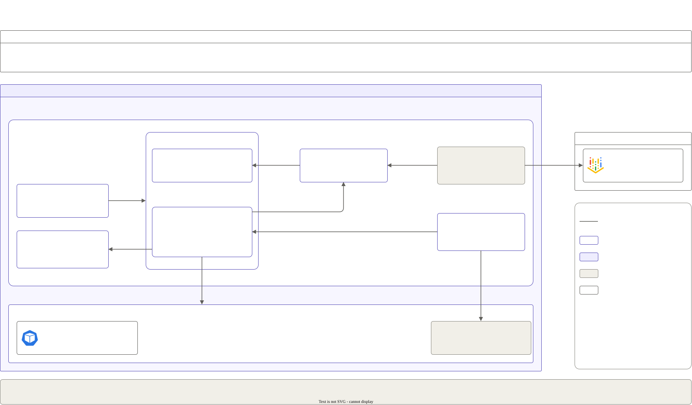

# P3: LLM observability and SLOs

Traces, the right metrics, SLOs (service level objectives) with burn-rate alerts, and cost per team for the P2 gateway and P1's vLLM. A game day then breaks things on purpose to prove the alerts fire.

**Status:** in progress since 2026-10-19. No session has run yet, so nothing here is measured in the cloud.



## What it runs (so far)

- **Monitoring:**
  - **One release:** P1's kube-prometheus-stack release, upgraded with P3's values ([`helm/monitoring.yaml`](helm/monitoring.yaml)). It adds Grafana, Alertmanager and kube-state-metrics; P1's KEDA keeps reading the same Prometheus.
  - **No disks:** data lasts one session.
  - **The charts create no Secret** (the operator and Helm keep their own):
    - Grafana has no admin user. Anyone who reaches it is an anonymous viewer.
    - Alertmanager's config comes from an `AlertmanagerConfig` resource. Every alert goes to the alert receiver (below).
  - **Nothing here can read Secrets:** Grafana may read ConfigMaps in its own namespace only, and kube-state-metrics doesn't collect Secrets.
- **GPU metrics:** read from the NVIDIA DCGM exporter GKE already runs on GPU nodes, so P3 runs no exporter of its own. It's selected by pod name and an assumed port, because its labels aren't documented. Not proven yet: session 1 checks it.
- **Traces:** Tempo, a single binary with no disk: a scratch volume of at most 2 GiB goes with the pod ([`helm/tempo.yaml`](helm/tempo.yaml)). Grafana reads it as a second data source.
- **The collector:** P2's OpenTelemetry Collector, upgraded with P3's values ([`helm/otel-collector.yaml`](helm/otel-collector.yaml)).
  - It sends the gateway's traces on to Tempo.
  - Its span metrics connector turns traces into request, error and latency metrics, which Prometheus scrapes.
  - Labels: model group, team and status code only. The latency buckets include 2.5 s (the latency SLO's threshold) and chat-default's 10 s and 30 s timeouts.
  - Metrics refresh every 15 s, not the default 60 s, since that delay adds to every alert.
  - Running P2's `deploy.sh` again puts P2's collector values back. Run P3's after it.
- **SLOs (service level objectives) as code** ([`slos/platform.yaml`](slos/platform.yaml)), over a 28-day window. Sloth generates the burn-rate rules ([`slos/platform.rules.yaml`](slos/platform.rules.yaml)), and CI checks that the committed file is exactly Sloth's output.
  - **Availability:** 99.5% of teams' gateway requests return a non-5xx status. A 429 (budget or rate limit) is the gateway working, not an error.
  - **Latency:** 95% of vLLM's requests get their first token within 2.5 s, a bucket boundary in vLLM v0.30.0, so the ratio is exact.
  - **Alerts:** each SLO pages when its error budget burns 13.44x too fast over 1 h and 5 min, or 5.6x over 6 h and 30 min. It opens a ticket at 2.8x over 1 day and 2 h, or 0.93x over 3 days and 6 h. These are Sloth's 28-day windows.
- **Fallback alert** ([`slos/fallback.rules.yaml`](slos/fallback.rules.yaml)): over 10% of chat-default attempts fail (and fall back to the hosted model) for 10 min, with at least 3 attempts a minute.
- **Predicted time-to-alert** (promtool unit tests in [`tests/rules-test.yaml`](tests/rules-test.yaml), at a 1-minute rule interval; the game day measures the real one):
  - The gateway failing every request: ticket the minute the first errors land, page a minute later.
  - Every first token over 2.5 s after an hour of normal traffic: ticket after 2 min, page after 23 min. The good hour dilutes the 6-hour window.
  - vLLM dead: the fallback alert after 10 min (its `for`).
  - Quiet at 1% errors (a ticket only, no page) and at 0.5% fallbacks.
- **Alert receiver** ([`alert-receiver/receiver.py`](alert-receiver/receiver.py)): Alertmanager's only receiver, one stdlib Python file. It records each alert and the time it arrived, and serves them at `GET /log`. Nothing is sent outside the cluster.
- **Alert timing settings** (all part of time-to-alert): rules are evaluated every 30 s. Alertmanager groups by alert name and severity, so each alert has its own group, with `group_wait` 10 s, `group_interval` 1 min and `repeat_interval` 4 h. No alert fires all the time: there is no Watchdog, and the promtool tests check every alert is quiet with healthy traffic and with none.
- **Network:** nothing is public. Every Service is ClusterIP, reached by `kubectl port-forward`.
- **In CI on every pull request** (the gateway job, with the collector's and Tempo's configs rendered from their charts):
  - [`tests/test_metrics.py`](tests/test_metrics.py): a trace reaches Tempo, the span metrics reach Prometheus with only the chosen labels, and the scale-from-zero query returns a number.
  - [`tests/test_spans.py`](tests/test_spans.py), the span contract: the span names and attributes LiteLLM v1.103.3 sends, which P3's metrics are built from.
  - **No model on the request span:** the request (SERVER) span has the route, the status code and the team.
  - **Attempt spans:** each attempt at a model has its own span, with the model group, the team, the cost on success and ERROR on failure.
  - **No fallback flag:** a fallback is a failed `chat-default` attempt followed by a successful `chat-hosted` one.

## Run it

```sh
make up LAYERS="01 02 03"   # or "02 03" without the GPU: P3 then installs the Prometheus release itself
kubectl port-forward -n monitoring svc/prometheus-grafana 13000:80   # Grafana on http://127.0.0.1:13000
make down && make status
```

## Enterprise profile (documented, not built)

In production on GKE (Google Kubernetes Engine), managed services would replace the in-cluster pieces:

- **Metrics:** Google Cloud Managed Service for Prometheus instead of the in-cluster Prometheus. It uses the same PromQL queries, rules and Grafana dashboards. Google stores the data and runs the backend, so long retention needs no disks and no pods. It's billed per sample ingested, so the label rules here (team and model only) keep the cost down too.
- **Traces:** Cloud Trace instead of Tempo. The OpenTelemetry Collector sends to it with its Google Cloud exporter, under the collector's own Workload Identity, so there's no key.
- **Trade-offs:**
  - Per-sample and per-span charges replace a node's fixed cost.
  - Traces leave the cluster, though no prompt text is in them (P2 turns message logging off).
  - Switching back to self-hosted means re-pointing the collector and Grafana.

This project keeps everything in the session cluster, so it costs nothing when the cluster is gone.
