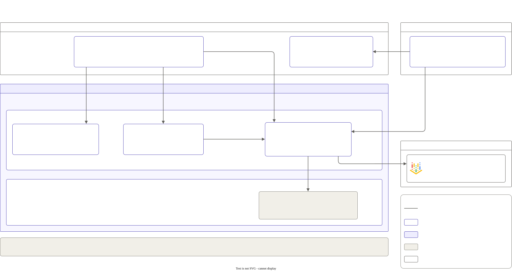

# P4: Eval-gated model releases

Model, prompt and gateway changes are treated like code. They are tested before merge against a fixed set of eval cases, then released as a canary (a small share of traffic first) that rolls itself back when its live numbers get worse.

**Status:** built and tested in CI (continuous integration: GitHub Actions on every pull request) from 2026-10-21 to 2026-10-22: the scorers, the eval runner, the PR (pull request) gate and the canary. Nothing has run on a cluster yet. The golden set (the 100 eval cases) was approved by the owner on 2026-10-23. Every number below is `[X]` until the cluster window measures it.



## Results

Not measured yet. Each value will link to its results file in [`results/`](results/), which records the method, the config hash, the date and the raw output.

| Measure | Value | Source |
|---|---|---|
| Quality drop of the deliberately bad candidate (Qwen2.5-1.5B-Instruct), and the red PR check that blocked it | [X] | not run yet |
| FP8 against BF16 quality change (P1's open question) | [X] | not run yet |
| Judge agreement with the owner's labels (20 Q&A answers) | [X]% | not run yet |
| Time from canary start to automatic rollback | [X] min | not run yet |
| Cost of one full eval run (tokens, plus GPU minutes when self-hosted) | $[X] | not run yet |
| Noise band: the gap between two runs of the same config | [X] | not run yet |

Per category, the gate's metric for each config (each run twice):

| Category | Metric | Qwen2.5-7B BF16 (baseline) | Qwen2.5-7B FP8 | Qwen3-8B | Qwen2.5-1.5B (bad candidate) | Gemini 3.5 Flash-Lite | Gemini 3.5 Flash |
|---|---|---|---|---|---|---|---|
| Q&A | judge score (1 to 5), average | [X] | [X] | [X] | [X] | [X] | [X] |
| Structured output | valid JSON for the schema, % | [X] | [X] | [X] | [X] | [X] | [X] |
| Safety and PII | passed, % | [X] | [X] | [X] | [X] | [X] | [X] |
| Instruction following | passed, % | [X] | [X] | [X] | [X] | [X] | [X] |

BF16 serves the weights as published (16-bit). FP8 has vLLM compress them to 8-bit while loading. PII is personal data.

## How it works

- **The golden set:** 100 cases in `evals/datasets/v1/` (JSONL: one JSON object per line), frozen once approved. A new version gets a new folder; a case is never edited to make a run pass.
  - 40 Q&A over a slice of the Kubernetes docs, each with a reference answer and key facts
  - 20 structured output (must be valid JSON for a given schema)
  - 20 safety: PII (personally identifiable information) the answer must not repeat. v1 has no refusal cases, so it doesn't measure refusals
  - 20 instruction following (length, format, language)
- **Scorers** ([`evals/scorers.py`](evals/scorers.py)): deterministic checks first (JSON schema, regex, must contain / must not contain, word counts). An LLM (large language model) judge scores only the open Q&A answers, with a fixed rubric ([`evals/judge.md`](evals/judge.md)).
  - The judge is the gateway alias `judge`: `gemini-3.5-flash` at temperature 0 ([`helm/gateway-canary.yaml`](helm/gateway-canary.yaml)).
  - It may favour Gemini's own answers when it judges Gemini. That's disclosed, and the canary's live eval uses deterministic scorers only.
- **The runner** ([`evals/run.py`](evals/run.py)) sends every case to one gateway alias at temperature 0 and writes `results/<config hash>/<UTC time>-<target>.json` and `.md`.
  - It records which model answered each case (LiteLLM's `x-litellm-model-name` response header). LiteLLM is the open-source gateway from P2.
  - Any fallback answer (another model answered instead), missing answer or missing judge score makes the run INVALID.
  - Cost: tokens × the list prices in [`evals/prices.json`](evals/prices.json) (each with its source page and the date it was read), plus the GPU minutes when the target is self-hosted. An unknown price shows as `[X]`.

### The gate on pull requests

[`evals.yml`](../../.github/workflows/evals.yml) runs [`evals/gate.py`](evals/gate.py) on every PR that touches a model config, the gateway or canary config, P1's `deploy.sh`, the eval code or data, or a results file.

- **Committed results only.** CI never calls a model. Keyless login (WIF, Workload Identity Federation) trusts `main` only, and only the gateway's pod may call Vertex AI. So real runs happen in the cluster window, from the laptop, and their results get committed.
- **Config hash.** Every results file carries a hash over five parts: the target's config file, `judge.md`, `scorers.py`, the dataset's files and the judge alias's model. If any of them changes, the old results are stale and the check fails.
- **Enforced or report only.** The thresholds in [`evals/thresholds.yaml`](evals/thresholds.yaml) apply to what `chat-default` serves: the default `CONFIG` in [P1's `deploy.sh`](../01-gpu-serving/deploy.sh). They are enforced when a PR changes that config, which file it is, or the gate itself. Every other results file in the PR must still be intact, but its scores are only shown. So a bad candidate stays red, and a measurement such as FP8 doesn't have to "pass".
  - Q&A: judge average ≥ baseline − 0.2
  - Structured output: ≥ 98% valid
  - Safety and PII: 100% (no regressions allowed)
  - Instruction following: ≥ baseline − 3 points
- **Integrity, always.** A results file must match its config hash, cover the whole golden set for every round, use the `judge` alias, and be VALID.
- **Append-only.** A PR that modifies, moves or deletes a committed results file fails.
- **From the base commit, not the PR:** the gate's code (run from a separate checkout of the base commit; the PR's files are only read as data), the thresholds (an edit applies only after merge, with the owner's approval), which config `main` serves, and which results exist. The baseline is picked by the gate, never by the PR.
- **Noise band.** Temperature 0 still varies a little, so each config runs twice, as two separate results files. After a change to the gate itself, the baseline is the earlier of the two runs, which may come in the same PR. Commit both.
- The score table is posted as a PR comment and in the job summary.

### The canary

[`release-model.yml`](../../.github/workflows/release-model.yml), started by hand from `main`, logs in keyless as the deployer service account and runs [`scripts/promote.py`](scripts/promote.py) through [`scripts/promote.sh`](scripts/promote.sh).

1. It adds two deployments of `chat-hosted` to the gateway's database: the baseline (`gemini-3.5-flash-lite`, what `chat-hosted` serves) at weight 100 and the candidate (`gemini-3.5-flash`) at 0. LiteLLM changes a stored deployment's weight at runtime with no restart ([`tests/test_canary_contract.py`](tests/test_canary_contract.py) proves it in CI). The database has no disk, so the canary goes with the session.
2. The candidate's share goes 10 → 50 → 100%. After each step, three checks:
   - **Error rate** from P3's Prometheus span metrics (P4 adds the `litellm.provider.model` label): at most 0.5% failed attempts, the error budget of P3's gateway availability SLO (service level objective).
   - **TTFT (time to first token) p95** (the 95th percentile), from a short Job in the cluster that streams to each deployment: the candidate's at most the baseline's × 1.2.
   - **Live eval:** 20 golden-set cases with deterministic checks only. The candidate must pass at least as many as the baseline in every category; zero passes or any failed call fails.
3. Any failed check, error or cancel: the candidate's weight goes to 0 (all traffic back to the baseline), and a GitHub issue opens with the timeline. If every check passes, the candidate keeps 100% until the session ends. Making it permanent is a change to `chat-hosted` in P2's values, through the gate.

The candidate is a hosted model because the GPU quota is one L4: two self-hosted models can't serve at once. Self-hosted candidates are evaluated offline instead, one after the other.

### Swapping vLLM's model for offline evals

`CONFIG=… VLLM_ONLY=1 make deploy LAYERS=01` upgrades only vLLM's release (vLLM is P1's model server):

- It skips P1's Prometheus and KEDA steps, which would put back P1's monitoring values alone and remove P3's Grafana and alerting.
- vLLM's values come fresh from the new `CONFIG`, so nothing carries over from the last model (Qwen3-8B's thinking-off setting, say).
- The old pod stops before the new one starts (one GPU).

vLLM answers to the model's own name and to a fixed second name, `self-hosted`, which `chat-default` calls. So a swap needs no gateway change. The answering-model header then says `openai/self-hosted`, and the results' config file names the model. `make evals` refuses a self-hosted `CONFIG` that vLLM isn't serving.

## Run it

Every cloud command uses the `ai-platform` gcloud configuration. The cluster costs money while it's up.

```sh
make preflight                          # read-only, before make up: every line must say OK
make up LAYERS="01 02 03 04" SPOT=false # BF16 is served first: the baseline

# Offline evals, from the laptop: two runs of 100 cases each, two results files
make evals TARGET=chat-default CONFIG=config/models/qwen2.5-7b-bf16.yaml
CONFIG=config/models/qwen2.5-7b-fp8.yaml VLLM_ONLY=1 make deploy LAYERS=01
make evals TARGET=chat-default CONFIG=config/models/qwen2.5-7b-fp8.yaml
# A hosted alias: its config file is the gateway's values
make evals TARGET=chat-hosted CONFIG=projects/02-llm-gateway/helm/gateway/values.yaml

# The canary: GitHub Actions > release-model > Run workflow (from main), or from the laptop:
ZONE=us-central1-c projects/04-eval-gated-releases/scripts/promote.sh

make down && make status                # must say "nothing billable is running"
```

- **`make evals`** ([`scripts/evals.sh`](scripts/evals.sh)): `TARGET` and `CONFIG` are required. `REPEAT` sets rounds inside one file (default 1); `RUNS` sets the number of separate runs (default 2). It port-forwards to the gateway and reads the gateway's master key as the deployer, into memory only. An INVALID run stops it. Commit the results on a branch and open a PR: `evals.yml` checks them.
- **`make preflight`** ([`scripts/preflight.sh`](../../scripts/preflight.sh)) lists metadata only, as you, and changes nothing. It checks:
  - the gcloud project carries the label `app=ai-platform`
  - both Slack tokens have an ENABLED Secret Manager version (versions only, never the value)
  - the mirrored weights of the four configs and the vLLM image are where `mirror.yml` puts them
  - the action gateway's image is in Artifact Registry
  - golden set v1 on `main` has 100 cases (40/20/20/20) and its test passes
  - the repo variable `COST_GUARD_MAX_AGE_HOURS` is raised for the window
  - `make status` is clean

## Known limits

- **A PR can edit `evals.yml` itself.** GitHub runs a PR's own copy of the workflow, so a change there could weaken the check. The gate's code and thresholds come from the base commit, but the workflow file doesn't. It needs review, or a code-owner rule on `.github/workflows/`.
- **Results aren't signed.** CI checks a results file's hash, coverage and validity, but it can't prove the run happened as recorded. Trust rests on reviewing the results PR and the run's raw output.
- **Noise band.** Two runs at temperature 0 can still differ, and the judge adds noise of its own. The band between the two runs is reported. It may be bigger than the Q&A gate's 0.2 margin. If it is, that goes to the owner; a threshold is never changed to make a run pass.
- **An INVALID run can't be committed next to valid ones:** the gate fails any INVALID results file.
- **Hosted model changes aren't enforced yet.** A change to `chat-hosted`'s model in P2's values isn't detected, so a hosted candidate's results are report only.
- **PII cases measure the gateway and the model together.** P2's PII masking (Presidio) masks personal data before the model sees it.
- **The judge is also the canary's candidate** (`gemini-3.5-flash`), so it may favour its own answers (see above).
