# P5: Agent action gateway

AI agents can now do real operations work: restart a stuck service, scale up before a sale, roll back a bad deploy. Giving one `kubectl` access to production is frightening: it can be wrong, it can be tricked by text it reads (prompt injection), and afterwards nobody can say exactly what it did. This project puts a gate between agents and Kubernetes: written rules decide, a person approves the risky calls, and every change is recorded and can be undone.

**Status:** built and tested on kind (Kubernetes in Docker) in CI (continuous integration): the policy, the MCP (Model Context Protocol) server, the CLI approver, the Helm chart and all 50 scenarios. The Slack approver is unit-tested, with Slack faked. Run on GKE (Google Kubernetes Engine) in a session on 2026-10-23: all 50 scenarios passed there too, with the LLM (large language model) risk summary on every call that needed approval. The end-to-end demo, with Claude Code as the agent and approvals in Slack, was run and recorded in the same session; the video and its audit records aren't saved in `results/` yet, so no demo numbers are published.



## The 7 steps every action goes through

An agent calls one of six tools: `get_status` (read-only), `scale_deployment`, `restart_deployment`, `rollout_undo`, `apply_manifest` (ConfigMap and Deployment only) and `undo_action`. Each write goes through these steps:

1. **Check.** The policy ([`policies/gateway.rego`](policies/gateway.rego), run by OPA, the Open Policy Agent) answers `allow`, `needs_approval` or `deny`, with reasons. It reads structured facts only. The agent controls the tool name and its arguments; the gateway fills in the rest itself: the namespace's `env` label, the time from its own clock, the team from the agent's token, the current replicas and the dry run's result. Code decides, never an LLM.
2. **Preview.** A server-side dry run of the exact change, as the gateway's own ServiceAccount, with a diff and the blast radius: pods affected, capacity change, and PodDisruptionBudget (PDB) violations ([`src/dryrun.py`](src/dryrun.py)). The dry run runs first, since the check reads its result. A failed dry run is always a deny.
3. **Explain.** For a call that needs approval, an LLM writes a 3-line risk summary from the facts, through the P2 gateway, which masks personal data with Presidio ([`src/risk.py`](src/risk.py)). It explains; it doesn't decide. If it fails or takes over 15 s, the summary says "unavailable" and approval still works.
4. **Approve.** A person answers in Slack, with Approve and Reject buttons ([`src/slack_approval.py`](src/slack_approval.py)). Only listed Slack users can answer, and the approver is recorded. Slack's Socket Mode means the gateway connects out to Slack, so nothing in the cluster listens for Slack. With no answer in 15 minutes, the request is rejected. On kind, the CLI (command line) approver stands in ([`src/approval.py`](src/approval.py)).
5. **Execute.** The change runs as the gateway's own ServiceAccount, whose RBAC (role-based access control) allows only the verbs these tools need, on Deployments and ConfigMaps (plus listing ReplicaSets and PodDisruptionBudgets), only in `dev`, `staging` and `prod`, and no Secrets ([`helm/action-gateway/templates/rbac.yaml`](helm/action-gateway/templates/rbac.yaml)). If the object changed after the dry run, nothing runs.
6. **Record.** An intent record before the change and a result record after it, with the request, decision, reasons, policy version, diff, before and after state, approver, result and an undo token ([`src/audit.py`](src/audit.py)). In the cluster, each record is one object in a Cloud Storage bucket that the gateway can create and read, but not overwrite or delete. On kind, it's a local file in the pod.
7. **Undo.** `undo_action(action_id)` puts the object back from the before snapshot. It goes through steps 1 to 6 like any call. It refuses if the object changed after that action, and only the team that made the action can undo it.

## Default policy

The rules are in [`policies/gateway.rego`](policies/gateway.rego); the limits, the freeze window and the break-glass team are data in [`policies/data.json`](policies/data.json). `opa test` checks every row ([`policies/gateway_test.rego`](policies/gateway_test.rego)).

| Situation | Decision |
|---|---|
| Any read-only call | allow |
| `dev` or `staging`: a write within the limits (scale, restart, rollout undo, apply, undo) | allow |
| `dev` or `staging`: a replica increase over 100% (a scale call or a Deployment manifest) | needs approval |
| `prod`: any write | needs approval |
| An irreversible change (a ConfigMap made immutable, which undo can't edit back), in any namespace | needs approval |
| Scale any Deployment to 0 in `prod` (a scale call or a manifest) | deny |
| More than 20 pods affected (the blast radius) | deny |
| A change freeze is active in `prod`: Friday 17:00 to Monday 08:00, America/Chicago time | deny, unless the `break-glass` team asks; then a break-glass approver must approve |
| A manifest that reaches into the node, in any container or init container: `privileged`, `hostNetwork`, `hostPID`, `hostIPC` or `allowPrivilegeEscalation` set to true, added Linux capabilities, or a `hostPath` mount | deny |
| A kind other than ConfigMap or Deployment, or a manifest that names a different namespace than the call | deny |
| The dry run fails, or would violate a PodDisruptionBudget | deny |
| An unknown tool or argument, a missing fact, or a namespace without a known `env` label | deny (fail closed) |

When rules disagree, any deny wins, then any reason to ask for approval, then allow. A call no rule allows is denied.

## Where this fits

MCP gateways with policy checks and human approval steps already exist, some of them open source. This project doesn't try to replace them. Its focus is the part that is specific to infrastructure:

- a dry run before acting
- blast-radius checks (pods affected, PodDisruptionBudgets)
- change windows and freezes, with an explicit time zone
- before and after evidence for each change
- undo

It's a plain MCP server over Streamable HTTP with a bearer token, so it could sit behind an existing MCP gateway like any other server. That setup hasn't been tried.

## Results

The [50 scenarios](evals/scenarios/) (20 safe, 15 risky, 15 dangerous, of which 6 are prompt-injection attempts) run in CI on every pull request. Each sends its tool call through the MCP server as an agent would. The kind column is from [scenarios-kind-ci-2026-10-23-ccbb707.md](results/scenarios-kind-ci-2026-10-23-ccbb707.md): one CI run on GitHub's Ubuntu 24.04 runner (4 CPUs), Kubernetes v1.36.4 on kind, the CLI approver answering approve. The GKE column is from [scenarios-gke.md](results/scenarios-gke-2026-10-23/scenarios-gke.md): one run on 2026-10-23 on the session cluster (Kubernetes v1.36.4-gke.1495002), from the laptop through kubectl port-forward, the CLI approver answering approve.

| Measure | kind (CI) | Caveat | GKE |
|---|---|---|---|
| Unsafe actions allowed (of 15) | 0 | Strict: a dangerous call sent for approval would count as allowed | 0 |
| Safe actions wrongly blocked (of 20) | 0 | Strict: a safe call sent for approval would count as blocked | 0 |
| Risky actions correctly sent for approval (of 15) | 15 | The CLI approver answered, not Slack | 15 |
| Prompt-injection attempts blocked | 6 of 6 | No LLM agent in the loop: the runner sends the call a fooled agent would make | 6 of 6 |
| Median added latency per action (excluding human wait) | 30.2 ms | Timed at the agent, through kubectl port-forward on the same runner, with the change itself. No LLM summary in it (kind has no P2 gateway); in the cluster, the summary can add up to 15 s to each call that needs approval. One run's value; the two superseded runs had 29.6 ms and 27.1 ms | 1479.2 ms (see below) |
| Undo success rate (reversible scenarios) | 100% (30 of 30) | The runner waits for each change to roll out before the undo (see Known limits). 1 irreversible scenario isn't undone | 100% (30 of 30) |

All 50 scenarios passed every check: the decision, the expected reason keywords, and the dry-run values where a scenario sets them. The earlier runs, superseded because they came from earlier commits, are in [scenarios-kind-ci-2026-10-22.md](results/scenarios-kind-ci-2026-10-22.md) and [scenarios-kind-ci-2026-10-22-a0978ed.md](results/scenarios-kind-ci-2026-10-22-a0978ed.md).

On GKE, all 50 passed every check as well. The GKE latency isn't comparable to kind's 30.2 ms: it was timed on the laptop, through a port-forward to the cluster in us-central1, and the 15 calls that need approval also wait for the LLM risk summary through the P2 gateway (a summary came back on all 15; kind has no P2 gateway). The medians by group, from [scenarios-gke.json](results/scenarios-gke-2026-10-23/scenarios-gke.json): safe 1378.4 ms, risky 2456.6 ms, dangerous 933.1 ms.

**Threat model:** [threat-model.md](threat-model.md) lists what can go wrong (wrong actions, prompt injection, over-broad credentials, token theft, approval spoofing, missing audit) and which control stops each, and what v1 doesn't cover.

## Run it on kind

No cloud and no Slack: [install.md](install.md) walks through it step by step on your own machine. To run the smoke test and all 50 scenarios on a throwaway kind cluster, as CI does:

```sh
cd projects/05-agent-action-gateway
docker build -t action-gateway:ci .
tests/kind-smoke.sh                                 # Linux
SMOKE_PYTHON=.venv/bin/python tests/kind-smoke.sh   # macOS: a Python with requirements.txt installed (install.md, step 2)
```

## Run it in the session

P5 needs P2 (layer 02) for the risk summary. Set up the Slack app first ([slack.md](slack.md)), then:

```sh
SLACK_CHANNEL_ID=C... SLACK_APPROVERS=U...,U... SLACK_BREAK_GLASS_APPROVERS=U... make up LAYERS="02 05"
```

- **Without Slack:** add `APPROVER=cli` and answer with `kubectl exec` (`src/approval.py`).
- **On a running cluster:** `make deploy LAYERS="02 05"`.
- **What `deploy.sh` does:** it applies the demo targets (`evals/base.yaml`), makes the action gateway's P2 team key, makes one agent token (printed once; only its hash is stored), and installs the chart with the image `mirror.yml` pushed, pinned by digest.
- **Connect Claude Code:** [slack.md](slack.md), section 5.

**The 50 scenarios on GKE.** From the repo root, with a Python that has `requirements.txt` installed (`.venv`, as in slack.md section 3). The runner stops before touching anything unless three variables are set:

- `EXPECT_CONTEXT`: the session cluster's kubectl context. The runner goes on only if `kubectl config current-context` is exactly this.
- `OWNER` and `SESSION`: the labels of every object it applies.

```sh
export KUBECONFIG=~/.kube/ai-platform CLOUDSDK_ACTIVE_CONFIG_NAME=ai-platform CLOUDSDK_CORE_DISABLE_PROMPTS=1
project=$(gcloud config get project)
zone=${ZONE:-us-central1-c}
export EXPECT_CONTEXT="gke_${project}_${zone}_ai-platform"
export OWNER=$(gcloud projects describe "$project" --format='value(labels.owner)')
export SESSION=$(gcloud container clusters describe ai-platform --location="$zone" --format='value(resourceLabels.session)')
COMMIT=$(git rev-parse HEAD) .venv/bin/python projects/05-agent-action-gateway/evals/run_scenarios.py \
  --cluster http://127.0.0.1:18080/mcp "projects/05-agent-action-gateway/results/scenarios-gke-$(date -u +%Y-%m-%d)"
```

- **For this run only,** the runner switches the gateway to the CLI approver and the test clock (the pod restarts), and adds one new agent token per scenario team.
- **Afterwards,** even if the run fails or gets a SIGTERM, it puts all three back one step at a time, and checks them. Ctrl-C is ignored while it does. If a step fails, it names the step and exits 1.
- **It opens its own port-forward** on port 18080, since the restart ends any earlier one.
- **Use the gateway for nothing else meanwhile:** the runner approves every pending request, and it deletes and re-creates the Deployments, PodDisruptionBudgets and ConfigMaps in `dev`, `staging` and `prod`.
- **The output** is `scenarios-gke.json` and `scenarios-gke.md` in that folder, marked GKE, with the cluster's Kubernetes version.
- **Tests:** the unit tests cover the switch and the restore with a stand-in kubectl. It ran on GKE on 2026-10-23 (Results, above).
- **It costs** 15 risk-summary calls through P2 (one per risky scenario), on the action gateway's own team key.

**If a cluster run was interrupted,** run this read-only check (with `EXPECT_CONTEXT` set as above) before anything else:

```sh
python3 projects/05-agent-action-gateway/evals/run_scenarios.py --check
```

It prints the approver, whether the test clock is on, and the token hashes a run left in the `agent-tokens` ConfigMap. It exits 1 if the clock is on or any hashes are left, and the runner won't start a new run until both are cleared. To clear them by hand: `kubectl -n action-gateway set env deploy/action-gateway -c gateway APPROVER=slack TEST_ONLY_CLOCK_FILE-`, then delete the listed hashes with `kubectl -n action-gateway edit configmap agent-tokens`.

## Known limits

- **Undo restores a ConfigMap's `data` only,** not its `binaryData`, labels or annotations. A Deployment's undo restores its whole `spec`.
- **An undo straight after a scale-up is falsely blocked.** The new pods aren't ready yet, and the gateway counts the pods the undo would remove as healthy ones, so it reports a PodDisruptionBudget violation. Kubernetes would remove the unready pods first. It fails closed: nothing changes, and the undo works once the rollout is done (`kubectl rollout status`). The scenario runner waits for that, so the 30 of 30 above depends on the wait.
- **The CLI approver's identity is self-declared:** it records whatever name `--by` gives. It's for kind and CI only; Slack sends the user's ID itself.
- **The audit records aren't signed.** Their protection is the bucket's permissions: the gateway can create and read objects, not overwrite or delete them, and the bucket keeps them 30 days. It isn't locked, since a lock can never be undone; locking is the production setting.
- **The Claude Code `timeout` setting hasn't been tried.** A call that needs approval can wait 15 minutes. The demo's `.mcp.json` sets a 20-minute timeout, and the gateway sends a progress message every 30 s while a call waits, if the agent asks for progress. Neither has been tried with Claude Code yet.
- **Three namespaces only:** the RBAC names `dev`, `staging` and `prod`.
